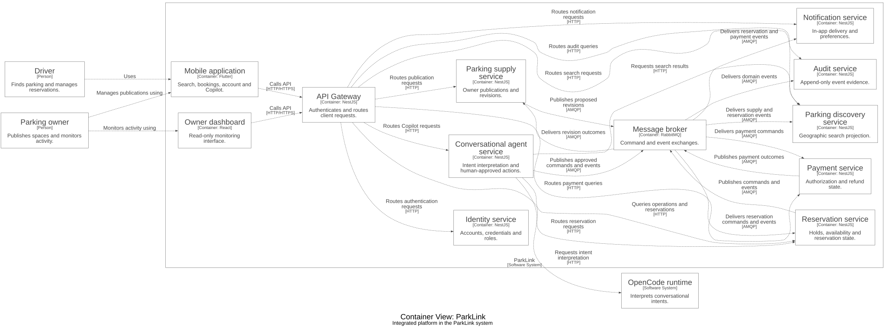

# Plataforma integrada de ParkLink

Espacio integrado del backend y el panel web de ParkLink. La aplicación móvil se mantiene en su propio repositorio.

## Responsabilidades

- Integra las copias de los componentes del backend y el panel en un espacio de trabajo npm y una configuración de Docker Compose.
- Define los límites entre servicios, bases de datos, mensajería, pruebas e infraestructura local.
- Los repositorios individuales son copias independientes y no se sincronizan automáticamente.
- La aplicación móvil se mantiene en [parklink-mobile](https://github.com/1ASI0728-2620-16363-ParkLink/parklink-mobile); el panel web también se publica en [parklink-web](https://github.com/1ASI0728-2620-16363-ParkLink/parklink-web).

## Tecnologías

TypeScript, NestJS, PostgreSQL/PostGIS, RabbitMQ, React y Flutter.

## Arquitectura C4

El diagrama presenta una **vista de contenedores C4** del sistema y sus relaciones. Se genera desde [Structurizr DSL](docs/architecture/workspace.dsl) con los estilos predeterminados, sin colores personalizados. Las flechas indican la dirección de las interacciones. El diagrama se conserva en inglés.



Para consultar o regenerar el diagrama, abra `docs/architecture/workspace.dsl` en Structurizr. Con Structurizr CLI y Graphviz instalados:

```sh
structurizr.sh validate -workspace docs/architecture/workspace.dsl
mkdir -p /tmp/parklink-diagram
structurizr.sh export -workspace docs/architecture/workspace.dsl -format dot -output /tmp/parklink-diagram
dot -Tsvg /tmp/parklink-diagram/structurizr-Containers.dot -o docs/architecture/containers.svg
```

## Descripción general

ParkLink es una implementación local de un mercado de estacionamientos adaptada de la aplicación Flutter PANAMERICANOS-MOBILE. Ocho servicios NestJS independientes tienen sus propias bases de datos PostgreSQL. RabbitMQ separa los comandos duraderos de reserva de los eventos de dominio confirmados. **No es una entrega completa para producción**; las limitaciones conocidas se describen más abajo.

## Inicio local

Requisitos: Docker Desktop con suficiente espacio y memoria, Node 22 y, para la aplicación móvil, Flutter 3.44.1 / Dart 3.12.1. Mantenga al menos 10 GB libres para compilaciones nativas y cachés de contenedores.

```sh
npm ci
node scripts/configure-local.mjs
docker compose up -d --build --wait
node scripts/seed-rich.mjs
```

`configure-local.mjs` genera credenciales locales aleatorias y no sobrescribe un archivo `.env` existente. En una instalación existente sin la contraseña del entorno aislado de OpenCode, ejecute `node scripts/configure-copilot.mjs`. Nunca imprima ni suba el archivo `.env`.

| Componente | Dirección local |
|---|---|
| Pasarela de API pública | http://localhost:3000 |
| Panel de propietarios de solo lectura | http://localhost:5173 |
| Administración de RabbitMQ | http://localhost:15672 (credenciales en el archivo privado `.env`) |
| OpenCode, bases de datos y servicios internos | Solo en la red privada de Compose |

La carga de datos de prueba crea la cuenta local `cliente@parklink.test`. Su contraseña aleatoria está en `.local/demo-accounts.json`, archivo ignorado y con permisos 0600; no se distribuye una contraseña de producción. Los datos son ficticios y todos los pagos son de prueba. Al repetir la carga se conservan los identificadores y las claves de idempotencia. Consulte los [datos de desarrollo](docs/development-data.md).

## Aplicación móvil

Clone [parklink-mobile](https://github.com/1ASI0728-2620-16363-ParkLink/parklink-mobile) y ejecute desde su raíz:

```sh
flutter pub get
flutter run -d YOUR_SIMULATOR_UDID --debug --dart-define=PARKLINK_API_URL=http://localhost:3000
```

En el emulador de Android, utilice `--dart-define=PARKLINK_API_URL=http://10.0.2.2:3000`. Las versiones de producción deben usar una dirección HTTPS de la pasarela. El punto de entrada heredado `legacy_transport_main.dart` se conserva como referencia y no inicia ParkLink.

Las compilaciones iOS pueden requerir ajustes de CocoaPods y firma en Xcode; consulte la documentación de la aplicación móvil. Los archivos de Firebase y las credenciales de firma no están incluidos.

## Asistente conversacional

Pulse dos veces la pantalla principal autenticada o el botón accesible del asistente. Seleccione un intervalo y solicite los estacionamientos más cercanos o económicos. Las búsquedas y acciones utilizan servicios reales. Las modificaciones requieren una confirmación vinculada al recurso y al precio; una retención no significa por sí sola un cobro ni una reserva confirmada.

El proceso independiente usa un servidor aislado OpenCode 1.19.5 y su SDK oficial, sin montar configuraciones ni credenciales personales. Consulte [la documentación del asistente](docs/copilot.md) para conocer los permisos, límites de datos y confirmaciones. La disponibilidad real de inferencia depende del proveedor; no debe asumirse que está funcionando sin comprobarla.

## Compilación y pruebas

```sh
npm run build
npm run lint
npm test
npm run test:integration
npm audit --omit=dev
```

Las pruebas de integración requieren los servicios locales de Compose y utilizan HTTP, PostgreSQL y RabbitMQ reales. Crean datos de prueba identificables y no reinician datos de producción. Para las pruebas móviles, ejecute `flutter analyze` y `flutter test` desde el repositorio `parklink-mobile`.

`node scripts/copilot-smoke.mjs` requiere una respuesta generada por OpenCode y devuelve un error si no puede obtenerla. No debe informarse como una prueba de inferencia exitosa cuando el proveedor no esté disponible.

## Servicios independientes y despliegue

Cada servicio tiene su propio `package.json`, `Dockerfile`, directorio de migraciones y `.env.example`. Por ejemplo:

```sh
npm run build:shared
npm run build -w @parklink/reservation-service
docker compose up -d --build reservation-service
sh scripts/image.sh reservation-service registry.example.com/parklink immutable-commit-tag
```

Los scripts de imágenes compilan localmente y no publican ni despliegan. Los servicios admiten `node dist/main.js --migrate`; las migraciones usan bloqueos por base de datos y sumas de verificación. Los paquetes compartidos contienen contratos y utilidades de infraestructura, no entidades de base de datos compartidas.

`infrastructure/helm/parklink-service` es una plantilla para una instalación Helm por servicio, con secreto existente, tarea de migración, comprobaciones de salud, HPA, PDB e ingreso opcional para la pasarela. Configure una conexión PostgreSQL propia y AMQPS para cada servicio. Los ejemplos de Kubernetes incluyen espacio de nombres, política de red y un recurso RabbitMQ de tres nodos. Estas plantillas no se han validado en un clúster real y no garantizan preparación para producción.

Consulte [arquitectura](docs/architecture.md), [RabbitMQ](infrastructure/rabbitmq/README.md), [operaciones de PostgreSQL](infrastructure/postgres/operations.md) y [auditoría de repositorios](docs/repository-audit.md).

## Contratos principales de la API

Todos los extremos protegidos requieren `Authorization: Bearer <JWT>`. Los importes se expresan en céntimos de PEN y las fechas usan RFC3339; la interfaz presenta la hora de Lima. Los servicios internos ofrecen `/health`, `/ready` y `/metrics`. En desarrollo, Swagger está disponible en `/docs` de cada servicio interno; la pasarela es el único punto público de entrada a la API.

| Extremo | Propósito |
|---|---|
| `POST /auth/register`, `/auth/login` | Registro y sesión móvil |
| `POST /auth/monitor-login` | Sesión de monitoreo de solo lectura |
| `GET /auth/me` | Perfil autenticado |
| `POST /spaces`, `PUT /spaces/:id`, `GET /spaces/mine` | Publicación y revisión por el propietario |
| `GET /discovery/search` | Búsqueda geográfica por intervalo, precio, características y orden |
| `POST /reservations/commands/hold\|confirm\|cancel` | Aceptación duradera; requiere `Idempotency-Key` y devuelve 202 |
| `GET /operations/:id` | Resultado persistido; la aceptación 202 no implica éxito |
| `GET /reservations/mine`, `/reservations/owner`, `/reservations/:id` | Consultas autorizadas de reservas |
| `GET /payments/mine`, `/payments/owner`, `/payments/:id` | Estado e historial de pagos |
| `GET /owner/dashboard` | Información agregada de solo lectura; indica si está truncada |
| `/notifications` y `/notifications/preferences` | Notificaciones internas y preferencias |
| `GET /copilot/status`, `POST /copilot/chat` | Estado y conversación autenticada del asistente |
| `POST /copilot/propose-hold`, `/copilot/propose-action` | Propuesta de consentimiento generada por el servidor |
| `POST /copilot/confirm/:id`, `GET /copilot/commands/:id` | Aprobación humana y resultado del comando |

Los contratos de colas e intercambios se describen en la guía de RabbitMQ. La búsqueda es informativa; el servicio de reservas vuelve a validar la disponibilidad. La cancelación gratuita incluye exactamente el límite de 60 minutos. Si no hay una política configurada, se rechaza la cancelación tardía en vez de inventar un cargo.

## Limitaciones antes de producción

- Faltan la carga privada de fotos, el editor de horarios recurrentes y bloqueos, las extensiones pagadas, la edición de perfiles y la incorporación verificada de propietarios.
- Faltan el envío por correo y notificaciones push, comprobantes fiscales, renovación o revocación de tokens y una separación completa mediante puertos de repositorio.
- El adaptador de Mercado Pago está preparado, pero no está certificado ni probado con credenciales reales; los pagos de prueba no son cobros reales.
- Deben completarse mTLS de producción, distribución de claves JWT asimétricas, permisos mínimos de base de datos y mensajería y políticas de salida.
- Las métricas que superan la ventana actual de 500 registros se marcan como parciales; no se ha demostrado un objetivo de carga o servicio de producción.
- No se ha realizado un despliegue externo, publicación de imágenes, consumo de IA de pago ni pagos reales.

## Notas sobre los repositorios públicos

Este repositorio integra el backend y el panel. Los repositorios de componentes del backend son copias independientes y no incluyen por sí solos la configuración npm ni los paquetes compartidos del espacio integrado. La aplicación móvil se mantiene en `parklink-mobile`.

Se excluyen los archivos de entorno locales, credenciales de firma, configuración de Firebase y la clave heredada de Google Maps. Si utiliza esas funciones, proporcione su propia configuración y una clave `GOOGLE_MAPS_API_KEY` restringida mediante `--dart-define`.
