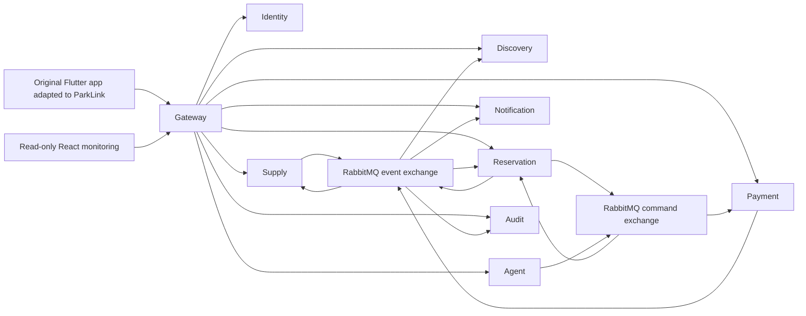

# ParkLink implementation boundaries

The eight NestJS applications and Gateway run in independent processes/images. Each persistence-owning service uses only its own PostgreSQL connection. Shared packages contain wire schemas and infrastructure utilities, never business entities or cross-service ORM models.

## Ownership

| Service | Private data | Authority |
|---|---|---|
| Identity | Users and scrypt hashes | Identity and role assignment |
| Supply | Publication payload, proposed/accepted revision | Commercial offer; publication lifecycle |
| Discovery | PostGIS offer documents, reservation windows | Informational search only |
| Reservation | Accepted snapshots, operations, holds, reservations, history | Final interval availability and state |
| Payment | Attempts, provider references, refund jobs | Financial outcome, never reservation writes |
| Notification | In-app notifications/preferences | Delivery only |
| Agent | Actor-bound expiring confirmations | Allowed search and human-approved hold proposal |
| Audit | Minimized append-only events | Evidence, not operational state |

## Durable command path

The public Gateway authenticates and forwards reservation command acceptance to Reservation. The ingress records an operation and command outbox atomically, returns `202` and `commandId`, then relays to the independent command exchange. This is a deliberate refinement of the report's Gateway-direct-publisher path: the SQL ingress avoids losing accepted commands during a Gateway crash. The reservation handler still executes only from AMQP, not from the HTTP controller. A successful acceptance is not a successful hold or payment. Poll `/operations/:id` for the persisted result, including a 409 conflict result.

Reservation holds use a PostgreSQL advisory lock per space, a half-open GiST exclusion constraint and explicit expiry transitions. Adjacent intervals do not conflict. Accepted supply revisions use that same lock; incompatible schedule changes are rejected and suspension does not delete existing reservations. Money is integer céntimos, PEN, with fractional hours rounded up to the next céntimo. There is one physical plaza per publication; multiple-capacity publication is not implemented.

Supply revision acceptance is asynchronous. A suspended offer may briefly remain visible in Discovery, but new holds use the accepted snapshot, not that projection. Old accepted conditions remain effective until Reservation applies a new revision.

## Payment saga

1. Hold persists a quote and a maximum ten-minute expiry.
2. Explicit confirmation enqueues an authorization request with its own attempt ID.
3. Payment persists the pending job before contacting its adapter; no SQL transaction remains open during provider calls.
4. Payment atomically publishes its outcome with local state.
5. Reservation validates amount, currency, attempt and expiry. A valid authorization confirms; an invalid or late one requests compensation, never resurrects a hold.
6. Cancellation releases the interval immediately and requests a refund separately. Refund processing remains pending until the adapter confirms it.

Late cancellation fees are intentionally unset. Without an approved configured policy, late cancellation returns 422. Free cancellation includes the exact sixty-minute boundary. Payment failures permit a retry only inside the smaller of five minutes and the original hold TTL.

## Deliberate differences and remaining architecture work

- Discovery uses durable PostGIS instead of the chapter V Redis-only projection, as requested; Redis is provisioned but unused.
- Core domain policies are framework-free. Some application handlers currently access `pg` directly. Full repository ports, aggregate mappers and dependency injection throughout all eight contexts are **not complete**; this is not claimed as fully layered tactical DDD.
- Internal HTTP is private-network HTTP in development. Production service-mesh mTLS, asymmetric JWT key distribution and per-service broker permissions must be completed by the platform integration.
- Copilot now includes search, human-approved hold/pay/cancel proposals and a mobile double-tap sheet with an accessible button. The isolated OpenCode runtime is enabled locally; free-model inference timed out during verification, so a clearly labelled guided fallback remains available. Extension tools are not implemented. See [Copilot](copilot.md).
- Notification delivery is in-app only. Push/email are not implicitly enabled by retaining the original Firebase dependency.
- No production SLO, throughput, fault-domain resilience, PCI compliance or fiscal-receipt compliance has been established by these tests.
